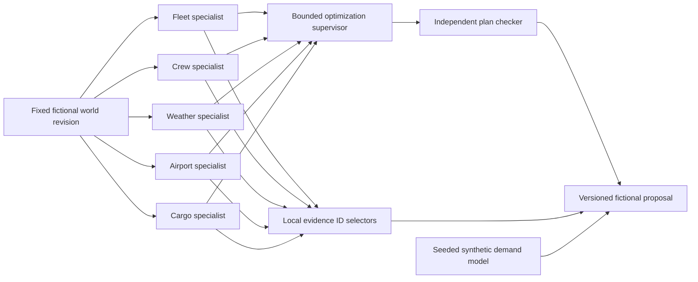

# Civilian relief engine: detailed implementation guide

## 1. What this system actually implements

This guide describes the working noncombat educational system in this repository. It is not a combat-engine build guide or a recipe for adapting the system to weapon allocation, adversary threat evaluation, military mission planning or targeting. The simulation accepts one fixed fictional relief scenario and five predefined perturbations. It cannot accept real operational datasets, arbitrary routes, risk models or user-defined optimization objectives through its API.

The engine proposes allocations of ordinary medical supplies, water, food and equipment among three fictional aircraft and three fictional crews. Each resource can be used once within a small toy planning horizon. Weather observations and airport closure reports affect feasibility; the engine never routes around adversaries or reasons about weapons. Proposals are displayed for inspection. No aircraft, crew or delivery is dispatched by this application.

There are three distinct kinds of intelligence. Deterministic constraint specialists evaluate the supplied fictional facts. A finite optimization search produces a proposal, and an independent checker verifies constraints and arithmetic. A fitted regression model forecasts synthetic demand for display. Finally, two local language models select already-verified finding IDs to highlight. Language models cannot generate assignments, override constraints, create numbers, invent evidence or execute tools.

This division answers the original concern about trying to train one enormous model from one unavailable dataset. Scheduling constraints do not need supervised training. A demand model needs its own carefully defined time-series data and evaluation. Language-model annotations need a narrow output contract and validation. These responsibilities share a versioned snapshot, not an unrestricted conversational black box.

## 2. Repository and module map

Run commands from `services/ingestion`. The implementation is in the isolated ingestion worktree, on `feature/logistics-ingestion`.

| File | Responsibility |
| --- | --- |
| `src/contracts.js` | Strict envelopes, source/event identities, ordinary cargo types, timestamp normalization |
| `src/store.js` | Immutable gateway history, projections, outbox, synchronous transactions/savepoints |
| `src/publisher.js` | Broker acknowledgment, retry/backoff, per-key ordering |
| `src/consumer-store.js`, `consumer.js` | Independent durable reader, dedupe, checkpoint, safe quarantine |
| `src/relief-world.js` | Fixed world, ordered perturbations, validated event mirroring |
| `src/relief-planner.js` | Five specialist reports, bounded optimizer, independent verifier |
| `src/relief-models.js` | Synthetic generation, ordinary least squares, held-out evaluation and forecasts |
| `src/relief-ai.js` | Local-only model configuration, structured ID selection, validation and fallback |
| `src/relief-service.js` | Command idempotency, revisions, atomic state/events, annotation coalescing |
| `src/app.js`, `monitoring.js` | Admin commands and authenticated read-only viewer API |
| `web/relief.js`, `relief.css` | Simulation inspection inside the existing monitor |
| `scripts/relief-demo.js` | Authenticated finite end-to-end scenario driver |
| `scripts/train-relief-models.js` | Reproducible synthetic training artifact |
| `scripts/relief-model-smoke.js` | Actual two-model validation and digest capture |
| `scripts/relief-ui-fixture.py` | Browser failure, accessibility and rendering fixtures |
| `compose.ai.yaml` | Pinned local Ollama runtime with cloud features disabled |

The backend deliberately stays in JavaScript. It uses the existing Node24, Express5, Zod, KafkaJS and SQLite dependencies. A separate Python orchestration service, LangChain graph framework, vector database or workflow automation platform would add deployment and failure surfaces without solving a requirement of this bounded scenario. Python is used for browser verification through Playwright.

## 3. First startup

Requirements are the versions in the module README: Node24.19 or later, npm11.17, and a running Docker engine for Kafka and optional local inference. Keep `.env` private. The generator refuses to overwrite an existing file.

```powershell
npm ci --ignore-scripts
npm run setup
npm run credentials
docker compose up -d --wait
```

Set `KAFKA_BROKERS=localhost:29092` in `.env`, then:

```powershell
npm run kafka:topics
npm start
```

In another terminal:

```powershell
npm run consumer
```

Open `http://127.0.0.1:3100/monitor/`. Enter only `MONITOR_VIEWER_TOKEN` from the private `.env`. The source tokens are for adapters; the admin token is for the local scenario driver. None belongs in browser storage. If an older credential file has no viewer setting, run `npm run viewer:credentials` once and restart the service.

In a third terminal:

```powershell
npm run relief:demo
```

The driver starts a fictional run, verifies exact command replay, and then sends one predefined phase roughly every six seconds. It prints revisions, objective values, proposal counts, unmet requests, validation status and annotation status. `--fast` compresses waits for smoke checks; a five-second browser poll can miss intermediate fast-mode revisions, though the retained history shows their summary.

Kafka is asynchronous. A proposed simulation plan is available once accepted locally; the independently running reader catches up from the outbox. Published outbox status confirms broker acknowledgment, not downstream processing. The reader runbook explains group offsets, capacity and rebuild procedures.

## 4. Starting the two actual local models

The default `RELIEF_AI_MODE=deterministic` performs no model request and labels its annotations accordingly. To use real local language models:

```powershell
docker compose -f compose.ai.yaml up -d
docker compose -f compose.ai.yaml exec -T ollama ollama pull gemma3:270m
docker compose -f compose.ai.yaml exec -T ollama ollama pull qwen3:0.6b
npm run relief:test:models
```

The compose file pins the Ollama image digest tested here, binds port11434 to loopback, caps CPU/memory, permits one loaded model and one parallel inference request, and disables cloud features. The model tags were verified against the official [Gemma3 library](https://ollama.com/library/gemma3/tags) and [Qwen3 library](https://ollama.com/library/qwen3/tags). Tags can change; the smoke captures the installed manifest digests in ignored `var/relief-model-smoke.json`. Record those digests when comparing experiments.

Set these values in your private `.env` and restart the API:

```dotenv
RELIEF_AI_MODE=ollama
OLLAMA_URL=http://127.0.0.1:11434
RELIEF_AI_TIMEOUT_MS=60000
```

The default model map alternates Gemma and Qwen across five specialists. An optional `RELIEF_AI_MODELS_JSON` must contain exactly fleet, crew, weather, airport and cargo, with explicit model tags. The environment example provides the complete JSON. The runtime URL must be a canonical loopback HTTP origin; credentials, paths, query strings, remote hosts and redirects are rejected. Inference remains optional: a missing model, timeout, malformed response or resource limit produces explicitly labelled deterministic fallback.

The actual two-model smoke succeeded on this machine with all five specialist selections validated. This proves the local requests and evidence contracts work; it does not establish superior reasoning or accuracy. Small models are suitable for the narrow selection contract, not general aviation decisions. They do not determine whether a plan is feasible or optimal. Local inference is slower than the deterministic search, so annotations can remain pending while a new plan is already available.

Official references: [Ollama structured generation](https://docs.ollama.com/api/generate), [Docker setup](https://github.com/ollama/ollama/blob/main/docs/docker.mdx), [cloud-disabling configuration](https://github.com/ollama/ollama/blob/main/docs/faq.mdx). The library APIs were checked through Context7.

## 5. The fictional world and its clocks

`createReliefWorld()` creates the only supported initial scenario. IDs inside the world begin `SIM-`. A run has a full UUID, revision0 and logical tick0. There are three departure slots, thirty fictional minutes per slot and two one-slot routes from a hub to a clinic or shelter. Three aircraft have different capacity and cold-storage metadata. Two crews are available and qualified; the third is resting. Four initial requests have ordinary categories and explicit synthetic priority values.

Cold storage, priorities, routes, duty slots and logical validity are **scenario metadata**. They were not inferred from the gateway's more limited event schemas. The simulation uses those explicit assumptions to demonstrate constraint evaluation. It is not a certification system and does not assess real pilot qualifications, maintenance release or weather suitability.

Two clocks coexist. Gateway `observedAt` and `validUntil` are wall-clock timestamps, with the same normalization and freshness rules as other events. Simulation `tick`, slots and `validThroughTick` are logical values advanced by predefined phases. At tick6, records valid through tick5 are excluded from simulation planning. This does not secretly modify the wall-clock validity of gateway projections. The UI labels the clock and fixture scope so that the two cannot be mistaken for one operational timeline.

Mirrored gateway entity IDs use `relief-<full-run-UUID>-<SIM-ID>`, preserving source/type/entity sequence isolation. Aircraft airport references and cargo endpoint references use the same namespace as mirrored airport entities. The full UUID prevents runs sharing an eight-character prefix from colliding. Every snapshot includes event IDs, cursors, sources, types and entity IDs under `evidence` for inspecting the accepted typed records.

## 6. The five specialists

Each specialist reads the same immutable world revision and returns `{agentId, findings, eligibleIds}`. A finding has an ID, static code, human-readable grounded message and relevant world entity IDs. There is no arbitrary tool calling or conversation loop.

| Specialist | Checks |
| --- | --- |
| Fleet | Reported available status, logical validity, location, capacity and cold-storage metadata |
| Crew | Available status, logical validity, relief-pilot qualification and full duty-window coverage |
| Weather | Fresh weather record for each endpoint, fixed fictional wind/visibility limits and blocking condition |
| Airport | Fresh capacity/status record, closure and per-slot arrival/departure capacity |
| Cargo | Ordinary category, positive mass, route, priority, deadline, cold-chain metadata and validity |

Findings are visible even if a language model does not highlight them. Source messages are rendered as text. Eligibility lists serve as structured communication to the candidate generator and search supervisor. This acyclic graph is easier to test than an all-to-all LLM discussion: the only paths are world → reports → candidates → optimizer → checker → evidence annotations → viewer.



## 7. How the optimization works

This is a small exact combinatorial search, not a large-scale route planner. For each request, the planner generates feasible tuples `(request, aircraft, crew, departureSlot, arrivalSlot)`. An aircraft must be located at the origin, available, fresh, sufficiently capacious and cold-capable if required. The crew must be available, fresh and qualified, and its duty interval must cover the entire delivery. Both endpoint airports and weather reports must permit the toy delivery. Arrival equals departure plus the fixed route duration and must meet the request deadline.

During search, a request is either assigned one feasible tuple or left unmet. A resource can be used once in the horizon. Airport departure and arrival counts are tracked by slot; choosing a tuple cannot exceed either capacity. Request order and candidate order are deterministic. Reaching the node budget stops further exploration and preserves the best feasible proposal already found.

The objective is lexicographic, rather than one opaque weighted sum:

1. Maximize the sum of priorities of served requests.
2. Among equal-priority solutions, minimize changed assignments of surviving previously assigned requests.
3. Among those, minimize total arrival-slot indices.
4. Resolve remaining ties consistently using stable identities/order.

For example, keeping an old assignment cannot justify losing a higher-priority ordinary relief request, because priority is evaluated first. Similarly, an earlier arrival does not outweigh service priority or the defined stability criterion. A request that cannot be served remains unmet with reason codes; constraints are not relaxed to make the dashboard look successful.

`diagnostics.explored` and `diagnostics.limit` explain computational bounds. The plan is labelled `optimal` only when the finite search completed. If the budget interrupted it, the label is `feasible_budget`. An empty feasible plan is legitimate when all routes/resources are blocked. The search's label is not an aviation safety certificate.

The mathematical size is deliberately small: at most five requests, three aircraft, three crews and three departure slots. Larger real logistics networks need a different specification, performance experiments and an appropriate solver; increasing a limit without those changes would invalidate the current quality contract. This guide does not supply instructions for operational military adaptation.

## 8. Why the checker is independent

`validateReliefPlan()` walks assignments directly against the world, rather than trusting specialist eligibility lists. It checks identifiers, unique requests/resources, slots, route endpoints, arrival arithmetic, aircraft capacity/cold storage, crew availability/qualification/duty window, logical validity, weather, airport status/capacity and deadlines. It recomputes objective fields using the supplied prior assignments.

The tests deliberately tamper with valid proposals: fabricated resources, resource reuse, unavailable aircraft, inappropriate cold storage, altered arrival times, deadlines, objective arithmetic and unsupported report metadata. Mutation checks confirmed that a wrong cold-storage predicate is detected. Small independent exhaustive-oracle cases verify optimizer behavior separately from the checker.

The checker certifies feasibility and reported arithmetic within the toy model. It does not independently prove a global optimum merely because a returned JSON object says `optimal`. That claim comes from completed bounded enumeration. Keeping these claims separate prevents an external or fabricated plan from gaining authority through a label.

## 9. Replanning, command identity and transactions

Admin commands are strict JSON. A command cannot supply arbitrary aircraft, weapons, routes or objectives. The start command has a scenario literal, UUID commandId and optional exact current run ID for deliberate replacement. The step command has a UUID commandId, current runId, expectedRevision and one of the next fixed phase names. Wrong revision, run, order or reused command ID with different content returns409 with no committed phase changes.

An exact retry returns the original saved response, marked replayed. It does not generate new event IDs, advance the revision, enqueue duplicate Kafka work or replace the current state with an old receipt. The response can be an older revision because it describes the original command; GET retrieves the current snapshot.

For a new command the synchronous transaction performs these operations:

1. Check retained command capacity and prior receipt/hash.
2. Derive the next fixed world.
3. Run the deterministic planner and independent checker.
4. Normalize and accept all mirrored fixture events through the gateway store.
5. Require every receipt to be new, current and queued. A conflicting or poisoned sequence stream aborts the entire phase.
6. Save the current world, proposal, validation, forecast, evidence, history and annotation-pending state.
7. Save the immutable command response and commit.

The gateway's inner acceptance transaction uses a savepoint inside the service's outer transaction. Therefore a failure writing simulation state rolls back event history, projections, outbox rows and command receipt together. Tests inject a failing SQLite trigger, constrain backlog capacity and poison a fixture sequence to verify this property. No network request or `await` occurs inside a transaction. Node's synchronous database calls block the event loop, so bounded input/search is essential. See [Node24 SQLite documentation](https://nodejs.org/docs/latest-v24.x/api/sqlite.html).

The current run keeps six revision summaries. Retained command receipts are capped at1000; capacity exhaustion fails closed. There is no silent history deletion to keep writes succeeding. The ordinary gateway retention endpoint does not remove simulation command receipts. A production retention/backup design is not provided by this demonstration; operate it on local development data.

## 10. Model annotation lifecycle

Committed plans do not wait for local inference. A background loop captures the runId/revision and five grounded reports, asks each configured local model for at most three finding IDs, validates the response and stores it only if the captured revision is still current. If multiple new phases arrive while a request is running, pending work coalesces to the latest snapshot. An old result cannot attach to a new run or revision.

The Ollama request uses `stream:false`, a strict JSON schema, `think:false`, temperature0, a fixed seed, bounded context/output and `keep_alive:0`. The response envelope must identify the expected model, be complete, and contain a JSON string with exactly the `findingIds` field. Post-validation rejects unknown IDs, duplicates, extra keys and malformed JSON. Grammar constraints help generation; post-validation remains mandatory.

Only one inference request is active at a time. Both advertised response length and streamed byte count are bounded. Timeouts abort fetch/body reading. Network status, missing weights, malformed output, excessive bytes and closed/busy states produce static fallback reason codes. Raw error messages, prompts, credentials and model prose are not put in logs. Model-generated free prose never enters the proposal.

`modelsUsed` includes models that actually passed validation. A fallback does not get reported as model success. The UI shows pending, deterministic, local model and deterministic-fallback states separately. Shutdown first aborts/waits for annotation work, then closes SQLite. A pending persisted snapshot resumes annotation after service restart.

## 11. The trained demand model and its dataset

Train the reproducible artifact:

```powershell
npm run relief:train -- --seed 26250 --samples 120 --output var/demand-model.json
```

The output file must be new: exclusive creation protects earlier experiments from accidental overwrite. The artifact records model kind/version, simulation flag, seed, sample count, feature definition, coefficients, training/test counts, exact split day IDs, evaluation and forecast bounds. Without `--output`, the JSON is printed. It contains no credentials.

The implemented generator creates a synthetic daily count series with a known trend, weekly components and bounded noise. Features are intercept, day/30, sin(2πday/7) and cos(2πday/7). Ordinary least squares fits only the training prefix. The last20% is held out chronologically, so a default120-sample experiment fits96 points and evaluates24 unseen points. The baseline predicts the training mean, not the held-out mean.

MAE is the mean absolute difference between predicted and actual synthetic counts on held-out days. For the default seed, observed MAE was approximately7.14 versus76.23 for the training-mean baseline. These numbers characterize this deliberately generated series; they are not evidence of real relief-demand accuracy. Forecasts are bounded finite nonnegative integers and do not create jobs or alter optimization constraints.

Regression tests verify more than an attractive error number. Training-only residual normal equations detect accidentally fitting held-out rows, and held-out error/baseline are recomputed independently. Keep chronology, provenance and evaluation targets explicit when changing the synthetic generator. Never use a low MAE from a leaked split as a selection-demo claim.

The world `demandHistory` is fictional scenario metadata. The displayed fitted forecast comes from the separately seeded training artifact, not from pretending that four cargo requests constitute a meaningful training dataset. The implementation deliberately does not fine-tune the local language models; their evidence-selection task uses constrained prompting and post-validation.

## 12. Public civilian data for future experiments

No external dataset is required to reproduce this system. Synthetic generation is the installed training path. For a separate civilian weather-research experiment, NOAA's [GHCN-hourly catalog](https://www.ncei.noaa.gov/products/global-historical-climatology-network-hourly) and [format documentation](https://www.ncei.noaa.gov/oa/global-historical-climatology-network/hourly/doc/ghcnh_DOCUMENTATION.pdf) provide historical weather observations. Verify current dataset versions, station metadata, units and quality flags before use. This is a possible data source, not an implemented adapter or trained weather model.

Weather measurements do not supply labels saying a flight is safe, and a historical archive is not a live feed. A civilian forecasting experiment should first define a measurable target such as next-hour station wind speed. Record station/time coverage, normalize units, handle missing/quality-flagged values, split chronologically and keep stations/time periods separated where generalization is being tested. Compare persistence and simple seasonal baselines before adding complicated models. Evaluate errors and uncertainty for that measurement target, independently of this toy scheduling demo.

For ordinary demand research, use a consented civilian organization's request history with a defined time-bin count target and known cancellation/duplication rules. Do not assume an unrelated public dataset contains aircraft availability, crew duty, cold-chain eligibility and cargo urgency labels. These are different data contracts. The current guide supplies no military dataset collection or combat training pipeline.

## 13. Browser and API contracts

The existing source/admin/viewer separation remains intact. The browser reads snapshots and cannot start or advance simulations. Admin commands are driven by the local CLI; viewer cookies grant only read endpoints. Authentication loss and even a failed logout clear simulation proposals, agent reports, forecast and annotation identifiers from the DOM. Tokens are never stored in localStorage or exports.

| Endpoint | Access | Meaning |
| --- | --- | --- |
| GET `/v1/simulation` | Admin bearer | Current snapshot or idle |
| POST `/v1/simulation/start` | Admin bearer | New fixed scenario;201 first acceptance,200 exact replay |
| POST `/v1/simulation/step` | Admin bearer | Next predefined perturbation;200 acceptance/replay |
| GET `/monitor/api/simulation` | Viewer session | Read-only, no-store current snapshot; no query parameters |

The UI shares the existing polling controller and generation guard. It does not create a second uncontrolled polling loop. A simulation endpoint failure does not erase successfully retrieved gateway facts; it shows an explicit unavailable/stale state. Simulation authentication failure ends the viewer session locally. Older responses and mismatched annotation revisions are discarded. Tables contain ordinary text, logical slots and explicit fictional labels; there is no operational map or execution button.

## 14. Demonstration sequence and expected outputs

| Revision | Phase | Expected served priority | What it demonstrates |
| --- | --- | --- | --- |
| 0 | initial | 9 | Capacity/cold chain and two available crews determine feasible choices |
| 1 | weather-change | 7 | Clinic weather blocks its toy route; ordinary shelter requests remain |
| 2 | maintenance-change | 7 | Unavailable aircraft is removed; a feasible replacement preserves priority |
| 3 | airport-closure | 0 | Closure plus remaining weather block yields an empty proposal |
| 4 | new-request | 10 | Weather/capacity reports recover; a new urgent water request changes the proposal |
| 5 | validity-expiry | 0 | Logical expiry excludes all outdated scenario inputs |

These values are asserted by tests, not hardcoded plan outputs. The optimizer must recompute assignments for every phase. Revision history displays the objective and changed assignment counts; unmet requests retain reasons. Annotation pending/fallback can occur independently of a valid deterministic proposal.

## 15. Testing and evaluation discipline

Run the baseline suite and source checks:

```powershell
npm test
npm run check
npm run contracts:check
npm run relief:test:ui
```

For native browser testing, install Python Playwright/Chromium as described in the module README, start the local gateway and run `npm run test:browser`. The retained relief fixture additionally tests keyboard focus/scroll preservation, disclosure state, failed/expired sessions, delayed old responses, safe text and provider/status labels. Real API/browser and fixture failures are reported separately.

With local Kafka enabled:

```powershell
$env:KAFKA_TEST_BROKERS='localhost:29092'
npm run test:kafka
npm run test:consumer:kafka
npm run smoke:pipeline
```

The tests intentionally include malformed broker records; test helpers isolate their own unique keys before parsing unrelated history. Production readers durably quarantine malformed records with safe metadata. Kafka delivery remains at least once, with event ID/content dedupe and source/type/entity sequence checks.

Required invariants are no duplicate resource use, every assignment feasible, no stale command mutation, exact command retry idempotent, no partial world/event transaction, finite search/memory, explicit provider failure, no unknown evidence accepted and no stale revision annotated. Record which tests were actually run, their runtime versions and model digests. Do not claim production availability or accessibility certification from a demo smoke.

## 16. Debugging common problems

| Symptom | First evidence to inspect |
| --- | --- |
| Startup fails | Private config validity; do not print tokens to diagnose it |
| Viewer denied | Separate viewer token and server restart; admin token cannot sign in |
| Viewer login behind a mapped port fails | Exact canonical `MONITOR_ORIGIN` for that browser origin |
| Broker disabled/queued | KAFKA_BROKERS and service restart; queued is durable acceptance |
| Reader fails | Group/database identity, row/page capacities, broker/TLS configuration |
| Simulation409 | Current run ID, revision, next phase and immutable command content |
| Fixture stream conflict | Authenticated source inserted a conflicting sequence; no phase committed |
| Empty proposal | Specialist reasons, logical expiry, closures/weather and qualifications |
| Feasible budget status | Search reached its node limit; do not relabel it optimal |
| Model pending | Local inference/loading latency; plan remains independent |
| Model fallback | Static reason code, local weights, timeout and response limits |
| Browser stale | Snapshot timestamp/network; displayed facts belong to that timestamp |

Use the systematic-debugging workflow: reproduce, identify the failing boundary, isolate one hypothesis, add a meaningful regression and rerun scoped checks. Avoid disabling warnings, dropping tests, relaxing schemas or removing hard constraints to get a green demo.

## 17. Permitted extension workflow

For this educational civilian engine, start a change with a written contract and a bounded fixture. Choose one independent capability, define its inputs/outputs and add a failing test. Preserve strict endpoints, explicit provenance, logical-clock labels and the independent checker. For example, a new ordinary relief request category requires a defined handling contract and tests; a new explanation model must satisfy the same evidence-ID schema and failure behavior. A model may explain verified facts without becoming the source of those facts.

Changes to persistence need a schema/migration strategy, backup and rollback evidence. Changes to solver size need benchmarks and honest budget labels. Changes to demand data need independent time splits and baseline comparisons. Changes to UI state need browser tests for focus, races, auth clearing and bounded rendering. Review the complete diff before integrating it into a shared branch.

This repository supplies no production deployment, real flight-control connection, certified safety process or combat-engine conversion instructions. The implemented artifact is complete for its explicitly bounded fictional civilian scenario, with reproducible commands and evidence, rather than a claim to solve the original combat-planning requirement.
