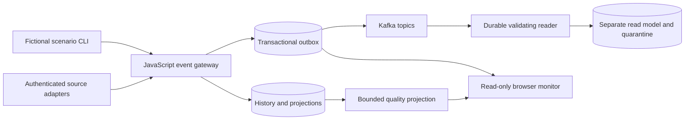

# Modules, contracts and demonstration

This increment implements generic administrative fact monitoring. It does not implement the problem statement's combat planning, weapons or threat-driven retasking capabilities. Reported availability is never converted into a readiness rating, resource assignment or operational recommendation. There is no trained predictive model, autonomous verdict or hidden LLM decision engine.

| Module | Responsibility | Storage / contract |
| --- | --- | --- |
| JavaScript gateway | Validate source identity, types, ordering, idempotency and TTL | SQLite history, source-specific projections and outbox; `/v1/*` |
| Durable publisher | Retry ordered per-key work, mark publication after broker ack | At least once; fixed five Kafka topics |
| Durable reader | Independently validate, deduplicate, quarantine and checkpoint | Separate single-owner SQLite database; see consumer runbook |
| Quality projection | Derive deterministic freshness, gap and differing-source indicators | Newest 1000 selected source assertions; no source authority guesses |
| Browser monitor | Inspect bounded facts, provenance, timestamps and delivery health | Read-only cookie API, five-second visible-tab polling |
| Finite simulator | Supply observable fictional updates using real authenticated APIs | `npm run scenario`; no browser write privileges |

The gateway and reader are separate projections. The browser shows accepted gateway facts immediately even if Kafka is unavailable. Queued/dead/published totals describe the entire gateway outbox, not the current filters or downstream consumer. The reader commits its own database before acknowledging Kafka; a subsequent failure can cause safe replay, rather than exactly-once delivery.

## A complete local demonstration

From `services/ingestion`, generate credentials if none exist, start Docker Kafka with `docker compose up -d --wait`, set `KAFKA_BROKERS=localhost:29092` in your private `.env`, run `npm run kafka:topics`, and start `npm start`. Run `npm run consumer` in another terminal. Open `/monitor/` and enter only the separate viewer token. Run `npm run scenario` in a third terminal.

| Approximate time | Observable change |
| --- | --- |
| 0s | Five fixture-prefixed administrative source assertions appear |
| 5s | Weather changes from clear to rain; source data and timestamps are inspectable |
| 10s | Aircraft source reports maintenance; skipped sequence and passed maintenance date are visible |
| 15s | Airport source reports closed with zero hourly capacities |
| 20s | Exact duplicate creates no additional history/outbox; stale assertion is archived without overwriting maintenance |
| 25s | Crew source reports rest with a short validity window |
| 35s | Crew assertion appears expired after a poll; no new source event or inference is needed |

Each CLI phase prints safe receipt metadata. Actual timings depend on requests and the dashboard poll. `var/scenario-last.json` contains fixture events, not tokens. Repeated runs use new entity names to avoid interfering with earlier sequence spaces. For a source-disagreement demonstration, configure a second authorized source of the same type and post a different valid assertion for the same entity. Both remain visible; no vote or hidden authority chooses one.

## Read-only API and quality semantics

GET `/monitor/api/snapshot` accepts only optional exact `sourceId` and `type` filters. It returns generatedAt, a scope limit/shown/truncated, summary, records, delivery and `deliveryScope: global_outbox`. Records are newest gateway projection cursors first. The response is one bounded synchronous read of gateway facts, not a global Kafka snapshot or an atomic snapshot across external sources. Summary counts and disagreement comparisons cover only selected records. A source filter can remove the other sources needed to observe disagreement; truncation can omit them too. Narrow filters and inspect provenance rather than interpreting absence of a flag as verified agreement.

| Flag | Exact meaning |
| --- | --- |
| expired | `validUntil <= snapshot time` |
| sequence_gap | Latest accepted receipt had a sequence greater than previous accepted sequence +1 |
| source_disagreement | At least two current selected same-type/same-entity assertions have different canonical `data` objects |
| maintenance_date_passed | Reported aircraft `maintenanceDueAt <= snapshot time` |

Different update times can explain differing source values. These flags ask for source review; they do not diagnose the aircraft, validate crew qualifications, forecast weather, prioritize cargo or recommend a plan. Freshness uses the service clock; clock synchronization is an external requirement. Validity changes automatically on a new snapshot. When polling fails, the UI retains the previous timestamped snapshot with a visible stale warning, so a displayed current badge belongs to that older snapshot time.

POST `/monitor/session` requires same-origin JSON `{token}`; POST `/monitor/logout` requires same-origin JSON `{}`. Viewer credentials are distinct from admin and source credentials. Sessions last 30 minutes, rotate on sign-in, stop at restart and are capped at 200. They use HttpOnly/SameSite=Strict cookies and no-store responses. The password field clears after submission; no tokens enter localStorage, exports, request URLs or logs. Failed sign-out clears local data but explicitly asks for a retry to confirm server revocation.

Without `MONITOR_ORIGIN`, session mutations require loopback HTTP with matching host/port. Remote browser use requires an explicit canonical HTTPS origin, e.g. `MONITOR_ORIGIN=https://monitor.example.org`, and actual TLS termination by a correctly configured operator-controlled proxy. HTTPS origins enable Secure cookies. The application does not provide a TLS terminator or trusted forwarded-header configuration. Do not expose plain HTTP with that setting or treat it as a deployment setup. Use one local service owner; in-memory viewer sessions and rate limits are not distributed.

## Validation and limitations

Automated tests cover contracts, transaction rollback, duplicate/source/time ordering, auth separation, CSRF origin checks, cookie rotation/expiry/capacity, body bounds, bounded snapshots and quality indicators. Real Kafka tests cover producer acknowledgment and independent groups, reader restart/broker rewind and safe quarantine. The retained browser smoke uses the real API to verify live updates/expiry, provenance, export, keyboard focus and 320/768/1024/1440px layouts. Fixture-heavy frontend checks additionally cover pagination, stale failures, safe text rendering and permission loss. Automated accessibility certification, multi-replica operation, live external data adapters and production deployment are not claimed.

Official implementation references: [KafkaJS consumption](https://kafka.js.org/docs/consuming), [Node24 SQLite](https://nodejs.org/docs/latest-v24.x/api/sqlite.html), [Express API](https://expressjs.com/en/5x/api.html), [Playwright Python](https://github.com/microsoft/playwright-python). Documentation was retrieved with Context7; the rendering code uses plain browser DOM APIs and no external runtime library.
